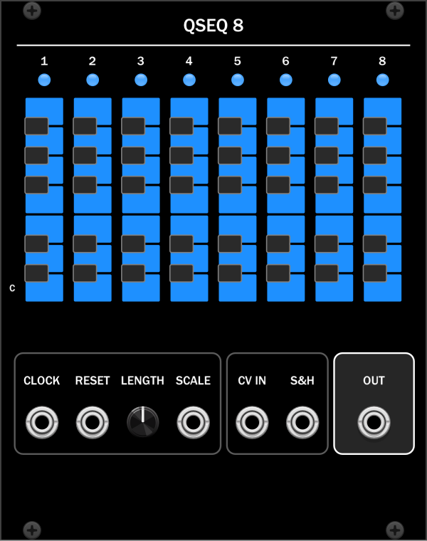

# Coming in Second

[VCV Rack 2](https://vcvrack.com) modules by **Coming in Second**, also ported to the
[4ms MetaModule](https://4mscompany.com/metamodule). The plugin currently contains
[QSeq 4, 8 and 16](#qseq-4-8-and-16).

## Download

**[Download the latest release](https://github.com/cominginsecond/ComingInSecond/releases/latest)**

| File | For |
|---|---|
| `ComingInSecond-<version>-win-x64.vcvplugin` | VCV Rack 2 on Windows (64-bit) |
| `ComingInSecond-v<version>.mmplugin` | 4ms MetaModule, firmware 2.4 or later |

Only Windows builds of the VCV plugin are available for now. On macOS or Linux, build it
from source (see [Building](#building)).

## QSeq 4, 8 and 16



QSeq 8 is a sequencer of eight quantizers. Each step has its own scale, set with a
column of piano keys. A clock moves from step to step, and the incoming CV is quantized
to the scale of the active step.

QSeq 4 (12HP) and QSeq 16 (38HP) are the same module with 4 or 16 steps. QSeq 4 puts
its jacks in two rows to fit the narrower panel. Everything below applies to all three.

### Controls

| Control | What it does |
|---|---|
| **Piano keys** (4, 8 or 16 columns × 12) | Each column is one step's scale, with C at the bottom. Click a key to add or remove that note. Every column starts as C major. |
| **Step lights** | The lit LED above a column marks the active step. |
| **LENGTH** | Number of steps in the sequence, from 1 up to the module's step count (4, 8 or 16). Columns past the length are faded. |
| **LENGTH CV** (jack under the knob) | Sets the length while it is patched, and the LENGTH knob becomes its attenuator: 0–10 V is split evenly from 1 step up to the knob's setting. With the knob all the way up, the CV covers every length (on QSeq 8, each 1.25 V adds a step). With the knob at 4, the same 0–10 V covers 1 to 4 steps. |

A white dot on a key marks the note currently being output.

### Inputs and output

| Jack | What it does |
|---|---|
| **CLOCK** | Each trigger advances to the next step, wrapping after the last one. |
| **RESET** | The next clock goes back to step 1. |
| **SCALE** | Selects the step directly: 0–10 V is split evenly across steps 1 to LENGTH. While it is patched, CLOCK and RESET are ignored. When you unplug it, the clock carries on from the last selected step. |
| **CV IN** | The 1 V/oct voltage to quantize. Polyphonic. |
| **S&H** | Sample & hold. When patched, the output only updates on each rising edge, and then holds. When unpatched, the output follows the input continuously. |
| **OUT** | The quantized 1 V/oct CV. It snaps to the nearest enabled note in any octave. If a step has no notes enabled, the input passes through unquantized. |

## Installing

**VCV Rack:** copy the `.vcvplugin` file into your Rack plugins folder, then restart Rack.
On Windows, that folder is `%LOCALAPPDATA%\Rack2\plugins-win-x64`.

**MetaModule:** put the `.mmplugin` file in a folder named `metamodule-plugins` at the
root of an SD card or USB drive. Then load **Coming in Second** from the plugins menu.
This needs firmware 2.4 or later.

## Building

### VCV Rack

You need the [Rack SDK](https://vcvrack.com/manual/PluginDevelopmentTutorial) and a
toolchain. On Windows, the toolchain is MSYS2 with the MINGW64 packages listed in the
Rack manual. Then run:

```bash
make RACK_DIR=/path/to/Rack-SDK
make install
```

`RACK_DIR` defaults to `C:/Rack-SDK`. The path must not contain spaces.

On Windows, the Makefile passes `-B` to make gcc use the assembler and linker in
`C:/msys64/mingw64/bin`. This works around stray `zlib1.dll` files in `C:\Windows\System32`
that break the toolchain's own copies. Set `MINGW_BIN` to change the folder.

### MetaModule

You need:

- the [metamodule-plugin-sdk](https://github.com/4ms/metamodule-plugin-sdk), tag `api-v2.4.0`;
- [Arm GNU Toolchain](https://developer.arm.com/downloads/-/arm-gnu-toolchain-downloads) 12.3 `arm-none-eabi`, on your `PATH`;
- CMake and Ninja;
- `rsvg-convert`, to regenerate the graphics.

```bash
cd metamodule
./make-assets.sh        # only needed after changing the SVGs
cmake --fresh -B build -G Ninja -DMETAMODULE_SDK_DIR=/path/to/metamodule-plugin-sdk
cmake --build build
```

The plugin is written to `metamodule/metamodule-plugins/ComingInSecond-v<version>.mmplugin`,
using the version from `plugin.json`. That is the file name 4ms requires for releases.

The MetaModule build compiles the same source as the VCV build. MetaModule-specific
code is behind `#ifdef METAMODULE`. On MetaModule, the piano keys are image-based
switches, because the MetaModule draws param widgets itself. The LENGTH knob there is a
silver image (`res/knobs/silver-knob.svg`), so it stands out on the black panel on the
small screen.

### Adding a module

All Coming in Second modules live in this one plugin. To add one:

1. Write `src/<Module>.cpp`. Include `house_style.hpp` there for the shared colors,
   labels, font, blue LEDs, knobs and screws.
2. Draw the panel as `res/<Module>.svg`.
3. Declare the model in `src/plugin.hpp`, and register it in `src/plugin.cpp`.
4. Add the module to `modules` in `plugin.json`, and to `MetaModuleIncludedModules`
   in `metamodule/plugin-mm.json`.
5. Add the `.cpp` to `target_sources` in `metamodule/CMakeLists.txt`.
6. Run `metamodule/make-assets.sh` to render the panel PNG.

## License

[GPL-3.0-or-later](LICENSE)
