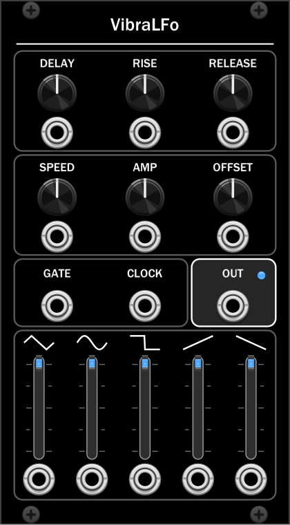

# Coming in Second

[VCV Rack 2](https://vcvrack.com) modules by **Coming in Second**, also ported to the
[4ms MetaModule](https://4mscompany.com/metamodule). The plugin contains
[QSeq 4, 8 and 16](#qseq-4-8-and-16) and [VibraLFo](#vibralfo).

## Download

**[Download the latest release](https://github.com/cominginsecond/ComingInSecond/releases/latest)**

| File | For |
|---|---|
| `ComingInSecond-<version>-win-x64.vcvplugin` | VCV Rack 2 on Windows (64-bit) |
| `ComingInSecond-v<version>.mmplugin` | 4ms MetaModule, firmware 2.4 or later |

Only Windows builds of the VCV plugin are available for now. On macOS or Linux, build it
from source (see [Building](#building)).

## QSeq 4, 8 and 16


QSeq 8 is a sequencer of eight quantizers. Each step has its own scale, set with a
column of piano keys. A clock moves from step to step, and the incoming CV is quantized
to the scale of the active step.

QSeq 4 (12HP) and QSeq 16 (38HP) are the same module with 4 or 16 steps. QSeq 4 puts
its jacks in two rows to fit the narrower panel. Everything below applies to all three.

### Controls

| Control | What it does |
|---|---|
| **Piano keys** (4, 8 or 16 columns × 12) | Each column is one step's scale, with C at the bottom. Click a key to add or remove that note. Every column starts as C major. |
| **Step lights** | The lit LED above a column marks the active step. |
| **LENGTH** | Number of steps in the sequence, from 1 up to the module's step count (4, 8 or 16). Columns past the length are faded. |
| **LENGTH CV** (jack under the knob) | Sets the length while it is patched, and the LENGTH knob becomes its attenuator: 0–10 V is split evenly from 1 step up to the knob's setting. With the knob all the way up, the CV covers every length (on QSeq 8, each 1.25 V adds a step). With the knob at 4, the same 0–10 V covers 1 to 4 steps. |

A white dot on a key marks the note currently being output.

### Setting notes from the menu

Right-click the module (on the MetaModule, open **Options** at the bottom of its parameter
list) and use **Set notes** to set a whole column of keys at once:

- **Step 1, Step 2, …**: each one shows that step's notes. Inside it, pick a root note, then a
  chord (major, minor, diminished, augmented, sus2, sus4, 7, major 7, minor 7, minor 7 flat 5)
  or a scale (major, natural minor, harmonic minor, Dorian, Mixolydian, major and minor
  pentatonic, blues). The step's keys are replaced with exactly those notes.
  The same submenu has **Copy notes**, **Paste notes**, **Copy to all steps** and **Clear**.
- **All steps**: the same chords and scales, plus **Paste notes** and **Clear**, applied to
  every step at once.

Copied notes can be pasted into any QSeq, of any size. In VCV Rack, each menu action can be
undone with Ctrl+Z.

### Inputs and output

| Jack | What it does |
|---|---|
| **CLOCK** | Each trigger advances to the next step, wrapping after the last one. |
| **RESET** | The next clock goes back to step 1. |
| **SCALE** | Selects the step directly: 0–10 V is split evenly across steps 1 to LENGTH. While it is patched, CLOCK and RESET are ignored. When you unplug it, the clock carries on from the last selected step. |
| **CV IN** | The 1 V/oct voltage to quantize. Polyphonic. |
| **S&H** | Sample & hold. When patched, the output only updates on each rising edge, and then holds. When unpatched, the output follows the input continuously. |
| **OUT** | The quantized 1 V/oct CV. It snaps to the nearest enabled note in any octave. If a step has no notes enabled, the input passes through unquantized. |

## VibraLFo



VibraLFo is an LFO that only runs while a gate is high, or all the time when GATE is unpatched. It waits, fades in, and fades out
again when the gate ends, which makes it good for delayed vibrato. Five faders blend its
waveforms, and it can sync to a clock.

### Controls

| Control | What it does |
|---|---|
| **DELAY** | Time from the start of the gate until the LFO starts, 0–2.5 s. A gate shorter than this never starts the LFO. |
| **RISE** | Time for the LFO to fade in from silence to full AMPLITUDE once it starts, 0–2.5 s. |
| **RELEASE** | Time for the LFO to fade out after the gate ends, 0–5 s. At 0 it stops immediately. |
| **SPEED** | LFO rate, 0.05–20 Hz, with 5 Hz at noon. When CLOCK is patched, the knob clicks between clock ratios instead: 1/8x, 1/4x, 1/2x, 1x, 2x, 4x or 8x. That is how many LFO cycles happen per clock pulse. The ratio shows briefly in a white box at the top of the panel as you turn it. |
| **AMP** | Peak level of the LFO, 0–2.5 V. The knob is tapered so small vibrato depths are easy to set: noon is 0.22 V. |
| **OFFSET** | Voltage the LFO moves around, −5 to +5 V. This is also the output while the LFO isn't running. |
| **Mix faders** | One each for triangle, sine, square, ramp up and ramp down, shown by the drawing above each fader. They set the blend proportions. The mix is scaled so its peak never exceeds AMP, however many faders are up. Starts as sine only. |

### Inputs and output

| Jack | What it does |
|---|---|
| **GATE** | The LFO runs while this is high. Each new gate starts over: delay, then rise. With nothing patched, the LFO runs all the time. |
| **CLOCK** | Syncs the LFO. The tempo is measured from the gap between pulses, and the LFO cycle restarts on the beat. When clocked, the LFO stays locked to the beat between gates, instead of starting a fresh cycle on each one. |
| **OUT** | OFFSET plus the LFO. The LED next to it follows the LFO. |

### CV inputs

Every knob and fader has a CV jack directly under it. The CV is added to the control's
setting, and the result is limited to the control's range.

| CV jack | Scaling |
|---|---|
| **DELAY**, **RISE** | +10 V adds the full 2.5 s. |
| **RELEASE** | +10 V adds the full 5 s. |
| **SPEED** | 1 V/oct. When clocked, each volt moves one ratio step (each step doubles). |
| **AMP** | +10 V adds a full turn of the knob. |
| **OFFSET** | Added volt for volt. |
| **Mix faders** | +10 V adds the full fader travel. The fader's light shows the resulting level. |

## Installing

**VCV Rack:** copy the `.vcvplugin` file into your Rack plugins folder, then restart Rack.
On Windows, that folder is `%LOCALAPPDATA%\Rack2\plugins-win-x64`.

**MetaModule:** put the `.mmplugin` file in a folder named `metamodule-plugins` at the
root of an SD card or USB drive. Then load **Coming in Second** from the plugins menu.
This needs firmware 2.4 or later.

## Building

### VCV Rack

You need the [Rack SDK](https://vcvrack.com/manual/PluginDevelopmentTutorial) and a
toolchain. On Windows, the toolchain is MSYS2 with the MINGW64 packages listed in the
Rack manual. Then run:

```bash
make RACK_DIR=/path/to/Rack-SDK
make install
```

`RACK_DIR` defaults to `C:/Rack-SDK`. The path must not contain spaces.

On Windows, the Makefile passes `-B` to make gcc use the assembler and linker in
`C:/msys64/mingw64/bin`. This works around stray `zlib1.dll` files in `C:\Windows\System32`
that break the toolchain's own copies. Set `MINGW_BIN` to change the folder.

### MetaModule

You need:

- the [metamodule-plugin-sdk](https://github.com/4ms/metamodule-plugin-sdk), tag `api-v2.4.0`;
- [Arm GNU Toolchain](https://developer.arm.com/downloads/-/arm-gnu-toolchain-downloads) 12.3 `arm-none-eabi`, on your `PATH`;
- CMake and Ninja;
- `rsvg-convert`, to regenerate the graphics.

```bash
cd metamodule
./make-assets.sh        # only needed after changing the key, knob or fader SVGs
cmake --fresh -B build -G Ninja -DMETAMODULE_SDK_DIR=/path/to/metamodule-plugin-sdk
cmake --build build
```

The plugin is written to `metamodule/metamodule-plugins/ComingInSecond-v<version>.mmplugin`,
using the version from `plugin.json`. That is the file name 4ms requires for releases.

The faceplate PNGs (`metamodule/assets/<slug>.png`) are rendered by VCV Rack, with the
panel labels and icons baked in. On the MetaModule, every widget that draws itself shows up
as a "display" in the module's element list, so the modules skip their static labels and
icons there (`PanelArt` in `src/house_style.hpp`). After changing a panel's SVG, labels
or layout, run this from the repo root (Windows, needs VCV Rack installed):

```bash
make dist
metamodule/bake-panels.sh
```

The MetaModule build compiles the same source as the VCV build. MetaModule-specific
code is behind `#ifdef METAMODULE`. On MetaModule, the piano keys are image-based
switches, because the MetaModule draws param widgets itself. The LENGTH knob there is a
silver image (`res/knobs/silver-knob.svg`), so it stands out on the black panel on the
small screen.

### Adding a module

All Coming in Second modules live in this one plugin. To add one:

1. Write `src/<Module>.cpp`. Include `house_style.hpp` there for the shared colors,
   labels, font, blue LEDs, knobs and screws.
2. Draw the panel as `res/<Module>.svg`.
3. Declare the model in `src/plugin.hpp`, and register it in `src/plugin.cpp`.
4. Add the module to `modules` in `plugin.json`, and to `MetaModuleIncludedModules`
   in `metamodule/plugin-mm.json`.
5. Add the `.cpp` to `target_sources` in `metamodule/CMakeLists.txt`.
6. Add labels and icons with `addPanelArt()`, and call `stripForPanelBaking(this)` at the end
   of the widget's constructor. Then run `make dist` and `metamodule/bake-panels.sh` to
   render the MetaModule faceplate.

## License

[GPL-3.0-or-later](LICENSE)
